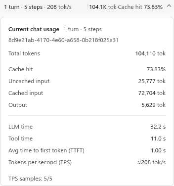
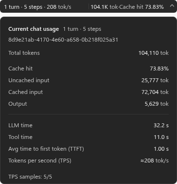

# Codex Usage Monitor

[English](README.md) | [简体中文](README.zh-CN.md)

A portable Windows x64 usage overlay for **Codex Desktop**. It shows the current chat's usage in the title bar and expands on click. It works without focusing the composer or modifying Codex Desktop.

| Light | Dark |
| :---: | :---: |
|  |  |

> These previews use sample data. Actual appearance may differ in the Windows app.

## Features

- **Current chat only:** Updates turns, steps, total tokens, cache hit rate, and estimated TPS when you switch chats.
- **Title bar display:** Click the overlay to expand a same-width panel with input, output, TTFT, and timing details.
- **Page-aware visibility:** Shows `-` for a new chat without data and hides on settings, plugins, and other non-chat pages.
- **Unobtrusive:** Temporarily hides during image previews, popups, menus, and search while statistics continue to update.
- **Customizable:** English and Simplified Chinese, light and dark themes, with settings applied immediately.
- **Desktop-aware:** Keeps a lightweight listener when Codex Desktop closes; no tray icon.

## Download and use

Download the standalone Windows amd64 EXE or the portable ZIP from **Releases**. Both use the same program and require no installation.

1. Put the EXE in a permanent location, or extract the portable ZIP.
2. Double-click `CodexUsageMonitor.exe` and open a chat in Codex Desktop. Either program can start first.
3. Click the overlay for details, or right-click it for **Settings**, **Status**, and **Quit**.

The first manual launch creates a Start menu shortcut for the current user and enables startup by default. You can disable startup from the overlay's right-click menu. Administrator rights are not required. After Quit, restart from the Start menu or EXE. If you move the portable folder, run the EXE from its new location once to update the shortcut.

## Metrics

| Metric | Meaning |
| --- | --- |
| Turns / Steps | Completed turns / unique model responses in the active history; tool calls do not count as separate steps |
| Tokens | Cumulative input and output tokens for the current chat; cached input is included in input |
| Cache hit | Cached input as a percentage of total input |
| TPS | Cumulative output tokens divided by estimated decode time for valid samples; `≈` in details marks the estimate |
| Avg TTFT | Average of valid time-to-first-token samples recorded for completed turns |

Statistics use only verified active chat history and exclude reverted responses. When loading or source data is incomplete, `≥` marks a confirmed lower bound. TPS is not an exact per-response server generation speed; TTFT is not the time until text appears on screen.

## Local data

The monitor reads Codex Desktop's `sqlite\codex.db` chat catalog and the local session logs explicitly identified by Desktop. Older Desktop builds that only provide `codex-dev.db` are not supported. Older chats listed in the current catalog retain their verified log history.

Settings and status files are stored under `%LOCALAPPDATA%\CodexUsageMonitor\` by default. Do not upload personal logs or status snapshots when reporting an issue.

## License

This project is licensed under the [MIT License](LICENSE). Third-party attributions and licenses are in [THIRD-PARTY-NOTICES.md](THIRD-PARTY-NOTICES.md) and `LICENSES/`. This project is independent of OpenAI; Codex is a trademark of OpenAI.
