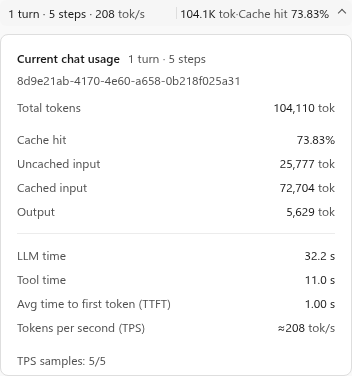
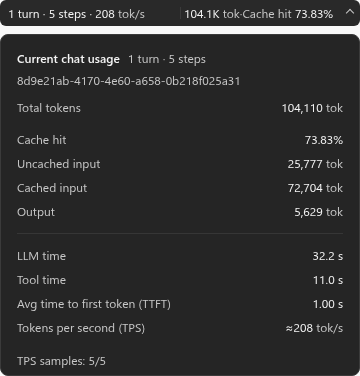

# Codex Usage Monitor

[简体中文](README.zh-CN.md)

A title bar overlay for Codex Desktop that shows token usage, cache hit rate, and estimated tokens per second for the current chat. Click for details. When Desktop closes, only a quiet listener stays running.

| Light preview | Dark preview |
| :---: | :---: |
|  |  |

Download from **Releases**.

- **Windows x64** — setup EXE or portable ZIP. Setup supports current-user or all-users installation (the latter requires administrator permission) and a choice of folder. The downloaded setup EXE can be deleted after installation.
- **macOS 13+ on Apple Silicon (preview)** — DMG; Accessibility permission required. The build uses an ad-hoc signature. Mac testing and notarization are pending.

Usage comes from verified local chat history. `≥` marks a confirmed lower bound when history is incomplete.

[MIT License](LICENSE) · [Third-party notices](THIRD-PARTY-NOTICES.md)
