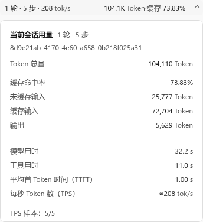
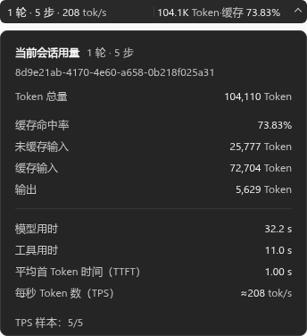

# Codex Usage Monitor

[English](README.md) | [简体中文](README.zh-CN.md)

适用于 **Codex Desktop** 的 Windows x64 便携统计栏。它在当前聊天窗口的标题栏显示会话用量，点击即可查看详情；使用过程中无需聚焦输入框，也无需修改 Codex Desktop。

| 浅色 | 深色 |
| :---: | :---: |
|  |  |

> 图片由项目布局预览生成，使用模拟数据；实际显示以 Windows 程序为准。

## 主要功能

- **只看当前聊天**：切换会话时更新 turns、steps、Token 总量、缓存命中率和估算 TPS。
- **标题栏中随手查看**：统计栏位于窗口右侧；点击展开同宽详情，查看输入、输出、TTFT 和计时等指标。
- **按页面自动显示**：新建聊天尚无数据时显示 `-`；设置、插件等非聊天页面隐藏统计栏，返回聊天后恢复。
- **避开临时遮挡**：图片预览、弹窗、菜单或搜索框出现时暂时隐藏显示，统计继续进行。
- **适应使用习惯**：支持 English / 简体中文、明暗主题；设置即时生效。
- **跟随 Codex 启停**：Codex 关闭后保留轻量监听器；程序不显示托盘图标。

## 下载与使用

在仓库的 **Releases** 页面下载 Windows amd64 单文件 EXE，或包含说明与许可证的便携 ZIP。两种下载使用同一程序，无需安装。

1. 将 EXE 放到固定位置，或解压便携 ZIP。
2. 双击 `CodexUsageMonitor.exe`，在 Codex Desktop 打开聊天页面。两者启动顺序不限，统计栏会自动出现。
3. 点击统计栏查看详情；右键打开 **Settings / 设置**、**Status / 状态**，或选择 **Quit / 退出**。

首次手动运行会为当前用户创建开始菜单入口，并默认启用开机启动；可在统计栏右键菜单中关闭，无需管理员权限。选择 Quit 后可从开始菜单或 EXE 再次启动。移动便携目录后，从新位置运行一次即可更新入口。

## 指标说明

| 指标 | 含义 |
| --- | --- |
| Turns / Steps | 当前有效历史中已完成的轮次 / 唯一模型响应数；工具调用本身不另计步骤 |
| Tokens | 当前会话累计输入与输出 Token；缓存输入已包含在输入中 |
| Cache hit | 累计缓存输入占累计输入的比例 |
| TPS | 按有效样本输出 Token 与估算解码时长累计计算；详情中的 `≈` 表示估算值 |
| Avg TTFT | 日志提供的已完成轮次的有效首 Token 时间样本平均值 |

统计只采用能够核验的当前会话有效历史，排除已撤销的响应；加载或资料不完整时，`≥` 表示已确认的下限。TPS 不是服务端逐响应的精确生成速度；TTFT 也不等于屏幕首字出现的时间。

## 本地数据

监视器只读访问 Codex Desktop 的 `sqlite\codex.db` 会话目录，以及 Desktop 明确指定的本机会话日志。不支持仅提供 `codex-dev.db` 的旧版 Desktop；当前目录中已有的旧会话仍会读取并核验其完整日志历史。

配置与状态文件默认位于 `%LOCALAPPDATA%\CodexUsageMonitor\`；排错时请勿上传个人日志或统计快照。

## 许可证

本项目采用 [MIT License](LICENSE)。第三方归属及许可信息见 [THIRD-PARTY-NOTICES.md](THIRD-PARTY-NOTICES.md) 和 `LICENSES/`。项目独立于 OpenAI，Codex 是 OpenAI 的商标。
