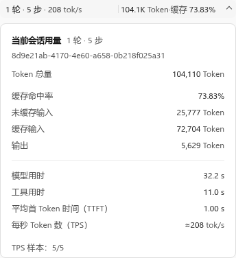
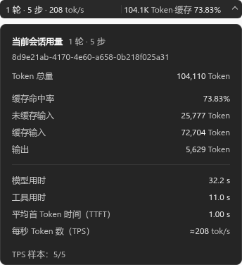

# Codex Usage Monitor

[English](README.md)

在 Codex Desktop 标题栏显示当前聊天的 Token 用量、缓存命中率和估算生成速度，点击可展开详情。关闭 Desktop 后只保留静默监听器。

| 浅色预览 | 深色预览 |
| :---: | :---: |
|  |  |

从仓库的 **Releases** 下载。

- **Windows x64** — 安装 EXE 或便携 ZIP。安装版可选择仅为我安装或为所有用户安装（需管理员权限），并可修改安装目录。安装后可删除下载的安装 EXE。
- **macOS 13+，Apple Silicon（预览版）** — DMG，需辅助功能权限。当前使用临时签名，实机验收与公证待完成。

用量来自已核验的本地会话历史。历史不完整时，`≥` 表示已确认的下限。

[MIT 许可证](LICENSE) · [第三方许可说明](THIRD-PARTY-NOTICES.md)
